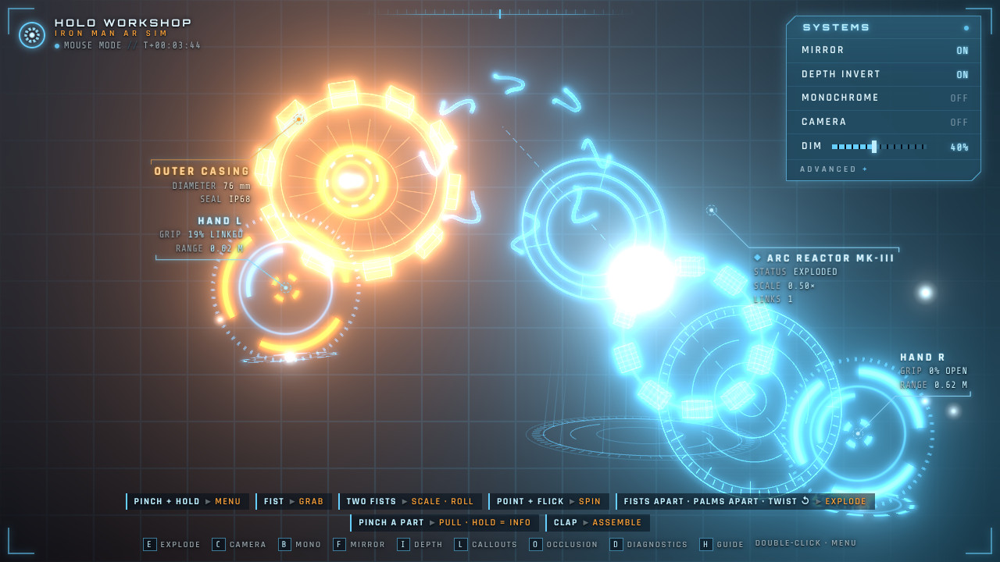

# HOLO WORKSHOP · Iron Man AR Sim

Workshop holograms in the style of the Iron Man films, controlled with your bare hands through an
ordinary webcam. Fabricate an arc reactor out of thin air, grab it with a fist, flick it into a
spin, rip it apart into an exploded view, pull parts out to inspect them, and clap to snap it back
together.

Everything runs locally in the browser: [MediaPipe Hand Landmarker](https://ai.google.dev/edge/mediapipe/solutions/vision/hand_landmarker)
tracks 21 landmarks per hand, and [three.js](https://threejs.org) renders the holograms with bloom
over your camera feed. There's no server and nothing is uploaded.



## Quick start

You need Node.js 20+ and a webcam. Recent Chrome or Edge track hands fastest; Safari and Firefox work too.

```bash
npm install
npm run dev
```

Open http://localhost:5173, click **ENGAGE**, and allow camera access.
No webcam? **MOUSE MODE** lets you play with the holograms using the mouse.

The first `npm run dev` copies MediaPipe's wasm runtime out of `node_modules` and downloads the hand
model (7.8 MB) into `public/`. After that the app works offline. If the download fails, the app
loads the model from Google's CDN at runtime instead.

> Browsers only allow camera access over `https://` or on `http://localhost`. To use the app on a
> phone, deploy it (see [Deploying](#deploying)) or tunnel your dev server over HTTPS.

## Gestures

Stand about 0.5–1.5 m from the camera in decent light, with your hands inside the frame. The guide
along the bottom of the screen summarizes these.

| Gesture | What it does |
| --- | --- |
| **Pinch + hold** (thumb + index, ~0.6 s) in empty space | Opens **FABRICATE**: Arc Reactor, Boot Thruster, Holo Globe |
| **Pinch + hold** on a hologram | Opens its **OPS** menu: Explode, Assemble, Reset Parts, Reset, Dismiss, Close |
| In a menu: keep pinching, slide toward an option, release | Selects it (or hover an option and pinch again) |
| **Fist** on a hologram | Grabs it; it follows your hand in 3D, including toward and away from the camera |
| **Two fists** on a hologram | Move it, scale it (spread or close the fists), and roll it (turn them like a steering wheel) |
| **Point + flick** your index finger | Spins the hologram the way you flicked |
| **Two fists pulled apart fast** | Explodes the hologram |
| **Palms together, then apart** | Explodes the hologram |
| **Twist a fist counter-clockwise** | Explodes the hologram |
| Exploded: **pinch a part** | Pulls it out; release to leave it floating there |
| Exploded: **keep holding the part** | Shows its spec callout, for example `OUTER CASING · DIAMETER 76 mm · SEAL IP68` |
| **Clap** | Reassembles every exploded hologram |

Reticles show what each hand is doing. They turn amber while you pinch or hold something, and a
grabbing fist glows orange.

### Mouse

| Input | What it does |
| --- | --- |
| Double-click | FABRICATE menu, or the hologram's OPS menu |
| Drag a hologram | Move it |
| Right-drag or Shift-drag | Rotate it; release mid-drag to fling it spinning |
| Mouse wheel | Scale it |
| Drag an exploded part | Pull it out; hold still for its spec callout |

### Keyboard

| Key | Action |
| --- | --- |
| `E` | Explode or assemble the focused hologram |
| `C` | Switch to the next camera |
| `B` | Monochrome camera feed |
| `F` | Mirror on/off |
| `I` | Depth invert: pushing your hand toward the screen pushes a held hologram away |
| `L` | Callouts for hands and holograms |
| `O` | Occlusion: your real hands hide holograms behind them |
| `D` | Diagnostics: landmarks, gesture readouts, tracker timing, event log |
| `H` | Gesture guide |
| `Esc` | Close the menu |

The **SYSTEMS** panel in the top right has the same switches, a **DIM** bar that darkens the camera
feed so holograms pop, and an **ADVANCED** section for touch screens. Settings are remembered per
browser.

## Deploying

`npm run build` writes a static site to `dist/`. It uses relative paths, so you can host it from any
directory on any static host.

The workflow in `.github/workflows/deploy.yml` type-checks, tests, builds, and publishes to
**GitHub Pages** on every push to `main`. To turn it on, go to the repository's
**Settings → Pages** and set **Source** to **GitHub Actions**. The app is then served over HTTPS at
`https://<user>.github.io/<repo>/`, so it works on phones too.

## URL parameters

| Parameter | Effect |
| --- | --- |
| `?video=<url>` | Uses a looping video file instead of the webcam |
| `?premirrored=1` | Treats that video as already mirrored, for example a screen recording of a selfie view |
| `?autostart=1` | Skips the start screen |
| `?delegate=CPU` | Runs hand tracking on the CPU, for GPUs with flaky WebGL drivers |
| `?clock=video` | Times gestures by the video's own timeline, so a recorded clip replays identically however slowly frames are processed |
| `?mirror=0`, `?debug=1`, `?labels=0`, `?occlusion=1`, `?depthInvert=0` | Forces a setting for this session |

## How it works

```
webcam ─► HandTracker (MediaPipe, VIDEO mode, GPU→CPU fallback)
            │ 21 image + 21 world landmarks per hand; lost hands looked for again, zoomed in
            ▼
         HandSet / TrackedHand
            identity by continuity · One Euro smoothing · metric depth from palm size
            3D reconstruction in camera space
            finger curls · pinch / fist / point / open states with hysteresis
            ▼
         GestureEngine ─► events: pinch/fist edges, flick, twist, clap, palms apart, fists pulled apart
            ▼
         InteractionController ─► menus, grabs, two-hand scale/roll, part dragging, callouts
            ▼
         three.js Stage: holograms + hand reticles + occluders ─► bloom ─► composite over the video feed
```

- **Camera-space AR.** The 3D camera's intrinsics match the visible part of the webcam image, so a
  point at the right depth lands exactly on the pixel where the webcam saw it. A hand's distance
  comes from weak perspective: the spread of the rigid palm landmarks in metres (MediaPipe world
  landmarks), divided by their spread in pixels, times the focal length. Each landmark then sits on
  its own pixel's view ray, which gives a metric 3D hand that occlusion and depth grabs can use.
- **Robust gesture states.** Thresholds were calibrated on real MediaPipe output. For example, a
  pinch with the other fingers curled looks like a fist by finger curl alone. Fingertip extension
  (index tip to wrist ÷ palm length) separates them: tucked fists measured 0.72–1.01, pinches 1.1
  and up.
- **Steady hand identities.** MediaPipe decides "left" or "right" for each detection on its own and
  now and then gets it wrong for a frame, which would swap your hands mid-gesture. The app keeps
  each hand's identity by where it just was. It trusts the label only for a hand that is just
  appearing, or one the classifier keeps calling the other side for several frames.
- **Hands further away.** The palm detector looks at the whole frame shrunk to 192 px, where a hand
  a couple of metres away is a few pixels wide. When it loses a hand it was tracking, the app looks
  again in a zoomed-in crop around where that hand just was. It never searches the frame blindly:
  in testing, that picked up hand-shaped objects in the background.
- **Holograms** are procedural three.js geometry: fresnel "glass" shells, additive glowing edges,
  and sprites, rendered into an HDR target with `UnrealBloomPass`. A final pass composites them over
  the mirrored, dimmed or monochrome camera feed in one WebGL canvas. Each object is a set of parts
  with assembled and exploded poses that move on damped springs, and it floats over a holotable
  projector pad.

### Project layout

```
src/
  app/          App orchestration and the InteractionController state machine
  core/         Viewport math (image ↔ screen ↔ camera space), One Euro filter, math helpers
  tracking/     MediaPipe wrapper, hand matching, zoomed re-finding, per-hand state, features
  gestures/     Motion-gesture detectors (pure, unit-tested) and the event engine
  objects/      Explodable hologram framework + Arc Reactor, Boot Thruster, Holo Globe
  render/       Stage (bloom + video composite), materials, hand reticles, occluders, effects
  ui/           SYSTEMS panel, floating callouts, ring menu, boot screen, diagnostics overlay
  config.ts     Every tunable: thresholds, filter constants, timings, render settings
tests/          Vitest unit tests (features, detectors, hand states, viewport, filters)
scripts/        setup-assets.mjs (wasm + model into public/)
```

### Adding a hologram

Create a file in `src/objects/` that exports an `ObjectSpec`: a title, menu names, and a list of
parts. Each part has a `build(look)` function that returns three.js geometry, plus its assembled
and exploded positions and its spec rows. Add the spec to `CATALOG` in `src/objects/catalog.ts`.
It then shows up in FABRICATE and works with every gesture. `src/objects/builders.ts` has helpers
for glowing circles, tick rings, glass boxes, and bands.

## Development

```bash
npm run dev         # dev server with hot reload
npm test            # unit tests
npm run typecheck   # TypeScript
npm run build       # typecheck + production build into dist/
```

Gesture thresholds and timings live in `src/config.ts`. Turn on diagnostics (`D`) to watch the live
curl, pinch, and extension values and the gesture event log while you tune them.

## Credits

- Hand tracking: [MediaPipe Tasks Vision](https://www.npmjs.com/package/@mediapipe/tasks-vision) (Apache-2.0) with Google's hand landmarker model.
- Rendering: [three.js](https://threejs.org) (MIT).
- Inspired by the workshop holograms in the Iron Man films and a hand-tracked hologram demo video.
